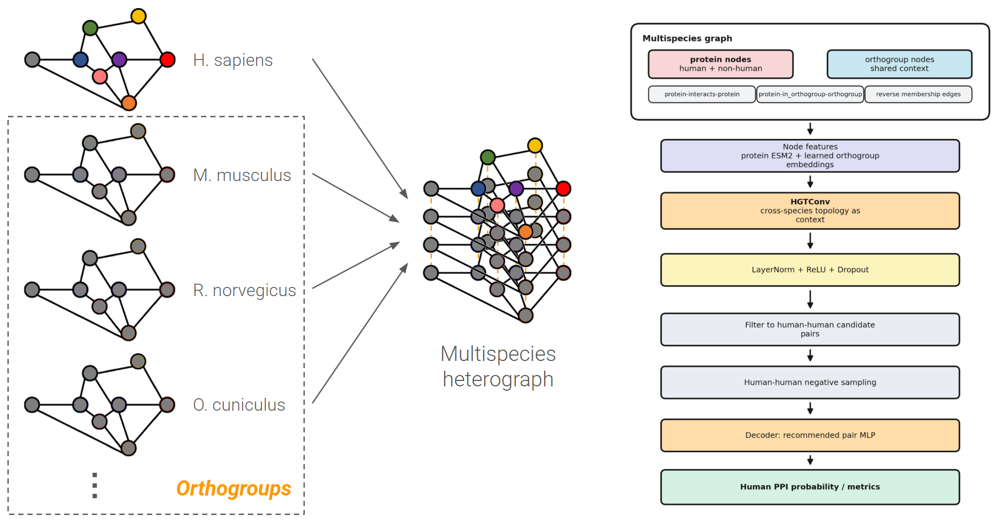

# ProtLink: Multispecies HGT for interactome prediction

ProtLink combines frozen ESM-2 protein embeddings, species-specific interaction networks, and orthogroup relationships to predict human protein–protein interactions (PPIs). It provides a sequence only baseline and a heterogeneous graph transformer (HGT) pipeline, together with API for controlled graph ablations and held out protein evaluation.

  

Detailed methods and experimental results are reported in this arXiv preprint: [arXiv](https://huggingface.co/straight-no-chaser/ProtLink-Multispecies-HGT)

🤗 **Model artifacts:** [ProtLink-Multispecies-HGT](https://huggingface.co/straight-no-chaser/ProtLink-Multispecies-HGT)